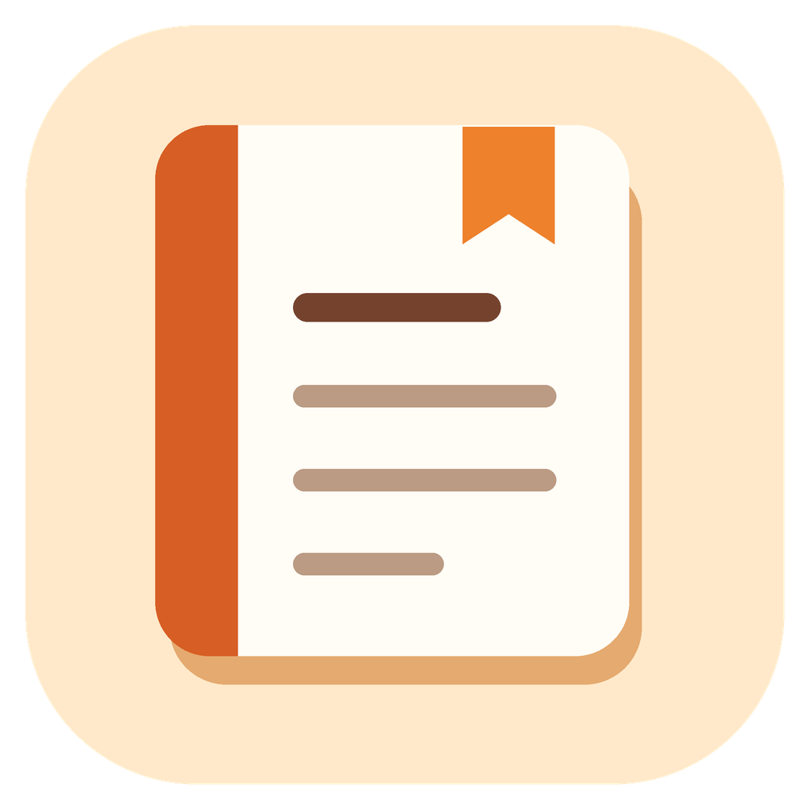
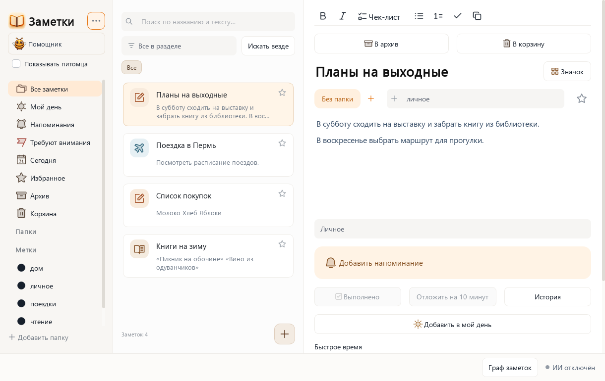

<div align="center">
  
  <h1>Orange Notes</h1>
  <p>Заметки, списки и напоминания. Записи хранятся на устройстве и доступны без интернета.</p>
  <p><a href="https://github.com/kirill548/OrangeNotes/releases/latest/download/Orange-Notes-Setup.exe"><strong>Скачать для Windows</strong></a> · <a href="#скачать">Другие платформы</a> · <a href="docs/README.md">Документация</a></p>
</div>



## Скачать

Последний выпуск [v0.2.3](https://github.com/kirill548/OrangeNotes/releases/tag/v0.2.3).

- **Windows x64.** [Установщик](https://github.com/kirill548/OrangeNotes/releases/latest/download/Orange-Notes-Setup.exe) или [портативный ZIP](https://github.com/kirill548/OrangeNotes/releases/latest/download/OrangeNotes-Windows-AMD64.zip). Для запуска из ZIP распакуйте весь архив и откройте `OrangeNotes.exe`.
- **Linux x64.** AppImage, DEB, Flatpak и tar.gz. [Скачать и установить](DISTRIBUTION.md).
- **macOS.** DMG и ZIP для Intel и Apple Silicon. [Скачать и установить](DISTRIBUTION.md).
- **Android.** [Тестовый APK](https://github.com/kirill548/OrangeNotes/releases/latest/download/OrangeNotes-Android-debug.apk).
- **iPhone (iOS 15 и новее).** [Неподписанный IPA](https://github.com/kirill548/OrangeNotes/releases/latest/download/OrangeNotes-iOS-unsigned.ipa). Перед установкой понадобится подпись.

На Windows установите v0.2.3 поверх v0.2.2 в ту же папку. Дальше Orange Notes будет сообщать о новых версиях при запуске. Проверку можно начать и вручную через «…» → «Проверить обновления». [Обновление и смена сборки Windows](docs/DESKTOP_UI_GUIDE.md#обновление-и-смена-сборки-windows).

[Контрольные суммы файлов](https://github.com/kirill548/OrangeNotes/releases/latest/download/SHA256SUMS.txt).

### iOS: установка приложения (.ipa)

Скачайте IPA, сверьте его SHA-256 и подпишите через AltStore Classic или Sideloadly. При бесплатной подписи её нужно периодически обновлять. [Подробная инструкция для iPhone](docs/IOS_DELIVERY.md#текущий-способ-установки).

## Что умеет Orange Notes

- **Папки, метки и поиск.** Заметки можно найти по названию или содержимому.
- **Ссылки между заметками.** Напишите `[[Планы на выходные]]`, чтобы сослаться на другую заметку. Связи видны в графе.
- **Напоминания.** На компьютере можно поставить напоминание на сегодня вечером, завтра утром или через час.
- **Диктовка.** На компьютере речь распознаёт локальный Whisper, на телефоне используется системный сервис.
- **Помощник.** На компьютере он может найти запись или подготовить черновик напоминания. С телефона можно отправить вопрос к настроенному Ollama на компьютере в той же сети. [Руководство по помощнику](docs/DESKTOP_UI_GUIDE.md#чат-и-пчёлка) · [Настройка мобильного подключения](docs/MOBILE_AI_RELAY.md).

Заметки хранятся в SQLite. Синхронизация между доверенными устройствами использует зашифрованное соединение. Сам файл базы и резервные копии приложение не шифрует. [Архитектура синхронизации](docs/P2P_SYNC_ARCHITECTURE.md).

## Запуск из исходников

### Windows, Linux и macOS

Нужен Python 3.12 x64. Выполните из корня репозитория:

```sh
python -m pip install -r requirements.txt
python app/main.py
```

[Сборка настольных пакетов](DISTRIBUTION.md#сборка-на-целевой-ос).

### Android и iOS

Перейдите в `orange_notes_mobile/`. Используйте версию Flutter из [Mobile CI](.github/workflows/mobile-ci.yml). Для сборки iOS нужны macOS и Xcode.

```sh
flutter pub get
flutter devices
flutter run -d <DEVICE_ID>
```

[Настройка Flutter и сборка мобильных пакетов](orange_notes_mobile/README.md) · [Сборка и подпись IPA](docs/IOS_DELIVERY.md).

## Проект и документация

- [`app/`](app/) содержит настольный клиент на Python и PySide6 и сервисы синхронизации и помощника.
- [`orange_notes_mobile/`](orange_notes_mobile/) содержит мобильный клиент на Flutter. Нативные части написаны на Kotlin для Android и Swift для iOS.
- [`docs/`](docs/) содержит инструкции, описание архитектуры и сценарии проверки.

Браузерная версия пока в планах. [План развития](ROADMAP.md) · [Журнал изменений](release_notes.md).

Сборки v0.2.3 прошли проверки на GitHub Actions. Отдельно проверена переустановка на Windows поверх запущенного приложения. [Настольные сборки](https://github.com/kirill548/OrangeNotes/actions/runs/45972385879) · [Мобильные сборки](https://github.com/kirill548/OrangeNotes/actions/runs/45972385877).

## Лицензия

Код Orange Notes распространяется по [лицензии MIT](LICENSE). Лицензии сторонних компонентов находятся в [`licenses/`](licenses/).
