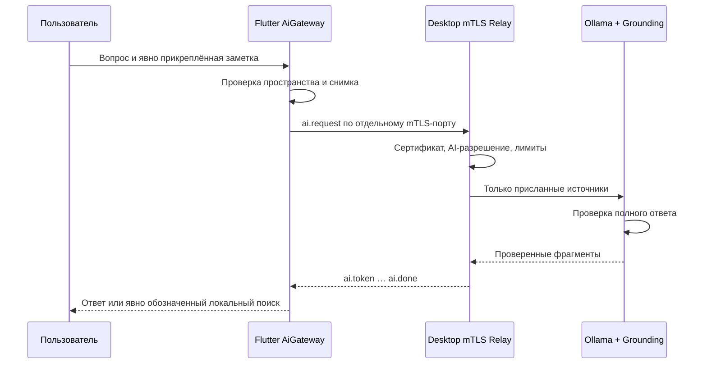

# Мобильный ИИ: защищённый Relay и локальный поиск

Статус: фаза 4 ветки `v0.2.0-dev`, экспериментальная реализация. Это не возможность опубликованной v0.1.5. Испытания на физических телефонах и в реальной Wi-Fi-сети остаются отдельным этапом.

## Как проходит запрос

1. Пользователь открывает помощника либо нажимает «Спросить ИИ по заметке» в редакторе. Редактор завершает обычное сохранение; помощник сам ничего не записывает.
2. Прикреплённая заметка показана отдельной меткой. Её можно убрать до отправки. Открытие чата не отправляет запрос.
3. После нажатия «Отправить» шлюз проверяет, что UUID, заголовок и текст снимка соответствуют текущей активной заметке данного пространства. Устаревший или чужой контекст отклоняется.
4. При настроенном отдельном AI-доступе устанавливается TLS 1.3 с двусторонней проверкой сертификатов и полного SHA256-отпечатка. Десктоп проверяет отдельное разрешение ИИ для пары actor/workspace.
5. Десктопный адаптер передаёт только явно приложенные источники в локальный Ollama. Он не выбирает произвольную базу или файлы компьютера по команде телефона.
6. Полный ответ модели проходит существующую проверку Grounding/StreamSegmentValidator. Только затем проверенные фрагменты передаются в чат. Это поток доставки проверенного ответа, а не немедленная публикация сырых токенов модели.

Схема: `Редактор → AiGateway → отдельный mTLS AI-порт → GroundedOllamaBackend → проверка источников → проверенные фрагменты → чат`.

## Разрешения и протокол

Синхронизация заметок и ИИ используют разные конечные точки. Наличие доверия для CRDT-обмена **не даёт** автоматического доступа к ИИ. В QR-конфигурации опциональное целое поле `ai_port` задаёт отдельный порт от 1 до 65535 и не может совпадать с `port` синхронизации. Сертификаты подключаются заранее. Пользователь подтверждает полный отпечаток; короткий PIN сам по себе не авторизует соединение.

Транспорт — ограниченные JSON-кадры с четырёхбайтовой длиной в TLS, **не HTTP/SSE**. Запрос `ai.request` содержит версию, UUID запроса, actor/workspace, вопрос и список снимков `{note_id, title, body}`. Ответы привязаны к запросу и передаются упорядоченно; клиент проверяет схему и границы потока.

Ограничения: вопрос до 8192 UTF-8 байт, не более 8 заметок, суммарный контекст до 32768 байт, кадр и вывод до 65536 байт, дедлайн до 30 секунд. Поддерживаются отмена, остановка по отзыву разрешения и безопасное завершение соединения. Сетевые исключения и содержимое сертификатов не показываются в чате.

Контекст считается недоверенными данными. Телефон не выбирает системный промпт, модель, адрес Ollama или инструменты записи. Канал только для чтения: он не создаёт задачи, напоминания и заметки и не объявляет их сохранёнными.

## Без десктопа

При отсутствии настроенного узла или до начала ответа при недоступности соединения используется детерминированный локальный поиск. Он показывает найденные фрагменты под подписью «Результаты поиска · на телефоне». Это не ответ локальной LLM. Отдельный облегчённый On-Device LLM пока не установлен и не квалифицирован.

Состояния чата: «Подключаюсь…», «Подключён», «Готовлю ответ…», «Недоступен · Локальный поиск на телефоне», «Остановлено». Состояние обмена заметками не выдаётся за состояние генерации ИИ. Частично полученный ответ не смешивается с новым локальным результатом при сбое.

## Код и проверка

- [Протокол и сервер](../app/services/p2p_ai_protocol.py), [адаптер Ollama](../app/services/p2p_ai_backend.py).
- [Мобильный шлюз](../orange_notes_mobile/lib/services/ai_gateway.dart), [привязка к текущему пространству](../orange_notes_mobile/lib/services/mobile_sync.dart).
- [Чат](../orange_notes_mobile/lib/presentation/ai_chat_screen.dart), [редактор](../orange_notes_mobile/lib/presentation/note_editor.dart).
- [Python-тесты Relay](../tests/test_mobile_ai_relay.py), [мобильные UI-тесты](../orange_notes_mobile/test/mobile_ai_widgets_test.dart), [тесты сессии](../orange_notes_mobile/test/mobile_sync_test.dart).

Mobile CI выполняет Dart format/analyze, Flutter-тесты, реальный обмен Python↔Dart по mTLS и нативные сборки Android/iOS. Десктопная матрица выполняет Relay-тесты и общую регрессию на Windows, Linux и двух архитектурах macOS. Проверки с тестовым backend не означают свежую квалификацию живой модели или испытание камеры/сети физического телефона. Итоговые числа тестов и ссылки на запуск фиксируются в отчёте конкретного коммита.


## Запуск десктопного узла

Сервис запускается явно, отдельно от синхронизации и окна заметок:

```sh
python tools/serve_mobile_ai.py --config /private/path/ai-relay.json
```

Пример административной конфигурации (UUID и отпечаток заменяются данными доверенного телефона; файлы сертификатов создаются и передаются отдельно):

```json
{
  "host": "192.168.1.10",
  "port": 7444,
  "certificate": "/private/path/desktop.crt",
  "private_key": "/private/path/desktop.key",
  "ca": "/private/path/ca.crt",
  "model": "qwen3:4b",
  "ollama_url": "http://127.0.0.1:11434",
  "ai_peers": [{
    "actor_id": "PHONE_DEVICE_UUID",
    "workspace_id": "SHARED_WORKSPACE_UUID",
    "fingerprint_sha256": "PHONE_CERTIFICATE_SHA256"
  }]
}
```

В подтверждённой QR-конфигурации десктопа для телефона задаётся `ai_port: 7444` дополнительно к отдельному порту синхронизации. Модель должна уже быть установлена в Ollama: сервис не скачивает её автоматически. Для доступа из LAN нужно указать локальный адрес вместо стандартного `127.0.0.1`; сервис не открывает правила брандмауэра самостоятельно. Этот этап пока рассчитан на настройку разработчиком, а не на мастер подключения в один клик.


