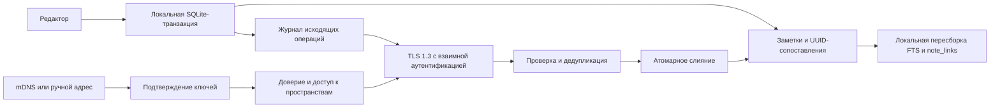

# Локальная P2P-синхронизация Orange Notes

Дата: 14 октября 2026. Ветка: `v0.2.0-dev`, исходная версия: `v0.1.5` (`d8dac59`).
Статус: архитектура и сетевой прототип фазы 2. Реализованы фоновый mDNS,
TLS 1.3 с взаимной аутентификацией и транзакционный журнал SQLite. Это явно
включаемый эксперимент на подготовленной копии одного пространства, без
автоматической синхронизации редактора и без мобильного клиента.
Подробности и ограничения: [сетевая фаза 2](P2P_NETWORK_PHASE2.md).

## 1. Границы и схема

Первая цель — обмен между явно сопряжёнными устройствами в одной локальной сети,
без аккаунта и центрального сервера. Интернет-посредники, NAT traversal, облачный
relay и общие публичные пространства в первую итерацию не входят. Недоступность
сети не блокирует редактор. Обнаружение не означает доверие или разрешение читать заметки.



Схема описывает целевой путь данных. Сетевой прототип связывает CRDT и
подготовленную UUID-копию SQLite через отдельный `P2PStore`. Обычный `Store`,
GUI и запуск приложения автоматически его не включают; существующая база не мигрирует.

## 2. Обнаружение устройств: mDNS / DNS-SD

Проектный тип службы: `_orangenotes._tcp.local.`. Имя экземпляра случайное и меняется
при новом окне подключения; TXT содержит только версию протокола, временный session ID
и возможности транспорта. Названия заметок, пространств, имя пользователя,
постоянный actor UUID и отпечатки доверенных устройств не публикуются.

mDNS и DNS-SD описаны в [RFC 6762](https://www.rfc-editor.org/info/rfc6762/)
и [RFC 6763](https://www.rfc-editor.org/info/rfc6763/). Реализация использует
Zeroconf на desktop; Bonjour/Android NSD остаются вариантами для будущего
мобильного клиента. `MdnsDiscovery` регистрирует службу только после явного `start()`.
Зависимость загружается лениво; отсутствие библиотеки не мешает обычному запуску приложения.
TXT содержит только версию, временный UUID сеанса и недоверенную подсказку сопряжения.
Фильтр пространства использует локальные разрешения, а не опубликованные UUID пространств.

В прототипе обнаружение запускает вызывающий код; будущий UI должен ограничивать окно
подключения, например 120 секундами. Сам сервис не открывает такое окно автоматически.
Закрытие окна и отмена освобождают объявления, сокеты и задачи. Кандидаты ограничены
по числу, размеру данных, частоте и времени жизни; интерфейс явно сообщает о запросе
доступа к локальной сети. Нельзя превращать адрес из объявления в произвольный URL,
следовать HTTP-перенаправлениям или автоматически подключаться ко всем найденным узлам.

Изоляция Wi-Fi, VPN, межсетевой экран и запрет multicast могут скрыть peer. QR/ручной
адрес заменяют обнаружение, сохраняя те же проверки доверия и разрешений. Локальная
сеть и `192.168.*` сами по себе не доказывают, что устройству можно доверять.

Имеющийся [UDP-эксперимент](MOBILE_P2P_PROTOTYPE.md) остаётся отдельным экспериментом:
он не является mDNS и не передаёт заметки. Его нельзя незаметно включать при старте.

## 3. Рукопожатие и защита канала

### ADR: TLS 1.3 с взаимной аутентификацией — базовый вариант

Для первой реализации выбирается mTLS поверх прямого TCP. TLS 1.3 определён в
[RFC 9846](https://www.rfc-editor.org/info/rfc9846/), заменившем RFC 8446;
требование TLS 1.3 для новых TLS-протоколов описано в
[RFC 9852](https://www.rfc-editor.org/info/rfc9852/). Проверяются обе стороны,
цепочки/доверенные сертификаты и привязка ключа к согласованной идентичности.
Запрещены `CERT_NONE`, принятие любого самоподписанного сертификата и неявный downgrade.
0-RTT для изменяющих данные запросов отключён.

Сертификат/ключ устройства не берутся из mDNS. Первое сопряжение требует внеполосной
проверки обоих ключей: обмена QR с полным отпечатком либо проверяемой строки,
криптографически связанной с рукопожатием. Разработка короткого кода без проверенного
протокола не допускается. Прототип `pair_peer_qr` требует полного SHA256-отпечатка сертификата и явного
подтверждения. Это программная граница проверки, а не готовый экран сканирования QR.
Один непроверенный шестизначный код недостаточен; PIN/PAKE не реализован.

Конкретные правила выпуска/проверки локальных сертификатов, SAN/имени peer, ротации
и привязки QR к ключам фиксируются отдельным security ADR и interoperability-тестами
Python/OpenSSL ↔ Dart/native TLS до первого сетевого релиза. Прототип использует заранее выданные сертификаты/ключи, доверенный CA,
проверку имени сервера и полные отпечатки обеих сторон. Автоматический выпуск,
ротация и защищённое хранилище ОС ещё не реализованы. В целевой версии устройства
должны хранить приватные ключи в защищённом хранилище ОС; копирование папки desktop-приложения не должно автоматически
клонировать доверенную идентичность. Шифрование диска/БД — отдельная задача, не свойство TLS.

Альтернатива — [Noise Protocol Framework](https://noiseprotocol.org/noise.html),
например XX с проверенными статическими ключами. Он требует аудированной библиотеки
для обеих платформ и такой же проверки идентичности. Протокол не переключается
между Noise и TLS автоматически при ошибке проверки сертификата.

### После рукопожатия

1. Стороны согласуют версию и ограничения. Авторизация привязывает аутентифицированный
   ключ к actor UUID и явно разрешённым workspace UUID.
2. Пользователь отдельно выбирает пространства. Совпадение названий «Личное» или
   числового `workspace_id=1` никогда не объединяет данные автоматически.
3. Перед каждой пачкой повторно проверяются доверие, отзыв и разрешённое пространство.
   При отзыве текущий сеанс закрывается. Отзыв не удаляет ранее полученные чужим устройством копии.
4. В первой сетевой версии peer публикует только свои операции. Пересылка операций
   третьего устройства потребует проверяемого происхождения и отдельного протокола;
   mTLS между A и B не подтверждает подпись C.

Лимиты целевого транспорта: ограниченный length-prefixed кадр, максимальный объём пачки,
дедлайн/отмена, ограничение параллельных сеансов, отсутствие сжатия до проверки размеров.
Сокет и SQLite работают вне GUI-потока; каждый SQLite-поток использует своё соединение.

## 4. UUID без разрушения v0.1.5

Немедленная замена `notes.id INTEGER PRIMARY KEY` на TEXT сломала бы существующие FK,
редактор, граф и SQL старого приложения. Поэтому прототип реализует переход двойной
идентичностью: локальные числовые ключи сохраняются, в сеть будут передаваться UUIDv4.
Формат UUIDv4 определён в [RFC 9562](https://www.rfc-editor.org/rfc/rfc9562.html).
UUID — идентификатор, а не пароль или доказательство доступа.

```text
sync_device(singleton PK, device_uuid UNIQUE, schema_version)
sync_workspaces(local_id PK, workspace_uuid UNIQUE)
sync_identities(entity, local_id, entity_uuid PK, tombstone)
  UNIQUE(entity, local_id) WHERE tombstone = 0

notes.id INTEGER PK             -> sync_identities('notes', id, UUIDv4)
folders/tags/reminders.id       -> соответствующие UUID-сопоставления
notes.workspace_id INTEGER     -> sync_workspaces.workspace_uuid
note_links.source_id/target_id -> UUID заметок, только производное представление
```

UUID пространств на независимых устройствах различны. Явное присоединение к одному
синхронизируемому пространству и сопоставление его локальному разделу — будущий
протокол, не побочный эффект миграции. Словари меток/папок существующей desktop-БД
общие: будущий экспорт обязан отбирать только метаданные доступных заметок,
не отправлять весь справочник из-за наличия UUID.

`app/database/sync_identity.py` предоставляет:

- `prepare_identity_copy(source, destination)` — новую UUID-копию;
- `identity_for(db, entity, local_id)` и `inspect_identities(db)` — просмотр сопоставлений;
- `export_legacy_copy(source, destination)` — копию без наших sync-объектов для v0.1.5.

Исходник не переписывается. Снимок делается через
[SQLite Backup API](https://www.sqlite.org/backup.html), включая зафиксированные WAL-данные.
Назначение не должно существовать; временный файл расположен рядом, готовая копия
публикуется через hard link без перезаписи другого файла. Для этой утилиты требуется
файловая система с поддержкой hard links; при их отсутствии копия не устанавливается.
Неудача не устанавливает частичный результат.
Миграция не подключена к старту приложения и не запускается на пользовательской базе.

Триггеры обеспечивают UUID для последующих legacy-вставок; удаление оставляет tombstone,
повторное использование числового ID получает новый UUID. Смена локального PK сохраняет
глобальную идентичность. Повторная подготовка копии сохраняет сопоставления.
Неполные или изменённые sync-таблицы/триггеры, некорректные UUID и устаревшие
сопоставления отклоняются: неизвестное состояние нельзя молча пересоздать после
повторного использования числового ID. При клонировании
устройства сохраняется `device_uuid`: до сопряжения копии нужна новая регистрация/ротация,
иначе два устройства могут создать одинаковые operation dots. Эта процедура ещё не реализована.

Граница совместимости проверена явно: точный `Store` из тега v0.1.5 открывает и изменяет
UUID-копию. Однако строгий механизм восстановления v0.1.5 намеренно отклоняет новые
sync-триггеры. Для него используется `export_legacy_copy`: проверка и восстановление
реальным кодом v0.1.5 сохраняют исходные таблицы, FTS, напоминания и граф. Экспорт
удаляет идентичность синхронизации, поэтому требуется новое сопряжение и полный снимок.
Защитный SQL-список v0.1.5 не расширяется; неизвестные SQL-объекты по-прежнему отклоняются.
Это совместимость пользовательских данных и прежнего приложения, а не прозрачное
восстановление будущих sync-метаданных старой версией.

## 5. Модель конфликтов

Концептуальная модель — карта сущностей с LWW-регистрами полей и независимым состоянием
жизненного цикла. Слияние выбирает максимальную метку `(Lamport clock, actor UUID)`;
часы устройства и часовой пояс в порядок не входят. Идея LWW-регистров/множеств описана
в [исследовании CRDT Shapiro и соавторов](https://www.lip6.fr/Marc.Shapiro/papers/2011/Comprehensive-CRDTs-RR7506-2011-01.pdf).
Правила ниже — проектные решения Orange Notes, не обещание посимвольного совместного редактора.

| Данные | Правило |
| --- | --- |
| Название и тело заметки | Независимые LWW-регистры; изменение заголовка не стирает конкурентное изменение тела |
| Удаление/восстановление | Отдельный `lifecycle`; обычное редактирование тела не восстанавливает удалённую заметку |
| Два состояния lifecycle | Детерминированный LWW; это не causal remove-wins. Конкурентное явное восстановление может победить удаление |
| Текстовые версии | В прототипе сохраняются 16 старших по меткам версий тела, включая победителя; это ограниченная история, не точный детектор конкурентности |
| Архив/избранное/напоминания | Планируются отдельные регистры и схемы; текущий wire-прототип их не поддерживает |
| Пространства | Отдельная авторизация и namespace; будущий CRDT для названия пространства не меняет членство/права |
| `note_links`/FTS | Не пересылаются как команды записи; пересчитываются из принятых заметок локально |

При одинаковом наборе допустимых дельт и ненарушенных лимитах состояние сходится
независимо от порядка и повторов. Повторный dot с другим содержимым — ошибка
протокола/клонированной идентичности; соответствующая пачка не применяется.

LWW всего тела выбирает один результат, не соединяет предложения. Будущий интерфейс
должен предлагать сравнение/восстановление версий. Ограниченная история может потерять
старые варианты; до выпуска требуется устойчивое хранение конфликтов и согласованная
компактация. Нельзя обещать «ни одна правка никогда не потеряется» по этому прототипу.

Индекс графа пересобирается из HTML-тела и wiki-ссылок. Его `id` и `context_snippet`
не являются независимыми реплицируемыми сущностями. Каскадное переименование заметок
из редактора должно в будущем включать все изменённые заметки в одну локальную
outbox-транзакцию; пересборка индекса не создаёт новых исходящих операций.
Существующие `[[Название|Подпись]]` в теле сохраняются как есть. При совпадении
названий цель остаётся неоднозначной, а не выбирается по случайному локальному ID.
Устойчивая UUID-привязка wiki-ссылки и конкурентное переименование требуют
отдельного формата/тестов; UUID заметки сам по себе не решает неоднозначность заголовка.

Перенос между пространствами не делается сменой поля в чужой дельте. Требуется
отдельная разрешённая операция переноса: tombstone в старой области и новое размещение
с явно согласованной идентичностью в целевой, без отправки нового текста старым получателям.
Атомарность такого переноса и экспорт напоминаний остаются открытыми задачами.

## 6. Дельты и транзакционный контракт

Реально реализованный формат `Replica.make_delta` / `Replica.apply_delta`:

```json
{
  "version": 1,
  "workspace_id": "c8d319d0-63af-4135-82bc-326568da249a",
  "actor_id": "8fc134fb-c2a4-49a4-9b19-cc8d967c9d15",
  "clock": 42,
  "ops": [
    {
      "entity_id": "90563b34-ebc0-4dda-b18e-99631a602a6a",
      "fields": {"title": "План поездки", "body": "<p>Проверить [[Билеты]]</p>"}
    }
  ]
}
```

Dot дельты — `(actor_id, clock)`, ID полей — dot плюс UUID сущности и имя поля.
Создание может включать `lifecycle: active`; удаление — `lifecycle: deleted`;
восстановление требует нового явного `active`. Это схема прототипа заметок;
прямые команды к `note_links` и неизвестные поля отвергаются. `body` — исходный
HTML/текст без неявного преобразования в Markdown, mobile сохраняет его без потерь.

Проверки текущего прототипа: канонические UUIDv4, точные поля JSON, запрет повторных
ключей, строгие целые счётчики без bool, отсутствие NaN, атомарный отказ всей пачки.
Лимиты: 256 КиБ на JSON, 32 операции, 1024 UTF-8-байта заголовка, 128 КиБ тела,
clock от 1 до `2^53-1`, 4096 сущностей, 8192 уникальные дельты и 8 МиБ принятой
канонической истории. Переполнение требует будущего полного снимка; старые dots
не выбрасываются молча. Количество и объём истории ограничены для разработки,
а не выбраны по измерениям мобильной нагрузки.

`Replica` работает в памяти, не является потокобезопасным и не проверяет сертификаты.
До `apply_delta` сетевой адаптер должен проверить аутентификацию и права. UUID внутри
JSON не авторизует пользователя. В фазе 2 отдельный `P2PStore` сохраняет историю CRDT в SQLite и восстанавливает
состояние при открытии. Реализованы ограниченные транспортные кадры и долговечные
подтверждения. Подписи отдельных операций и компактация ещё не реализованы.

Реализованный журнал фазы 2 (на подготовленной копии, одно пространство):

```text
sync_events(actor_id, clock, wire) PRIMARY KEY(actor_id, clock)
sync_outbox(sha256 PRIMARY KEY, wire)
sync_outbox_ack(sha256, peer_actor) PRIMARY KEY(sha256, peer_actor)
sync_inbox(sha256 PRIMARY KEY, actor_id, clock) UNIQUE(actor_id, clock)
sync_p2p_schema(singleton, version, workspace_id, local_workspace_id, actor_id)
```

Локальное изменение: `BEGIN IMMEDIATE` → заметки + версия регистра + outbox → `COMMIT`.
Приём: проверить кадр/доступ/схему → `BEGIN IMMEDIATE` → проверить dot и digest → применить
регистры и локальные заметки → inbox/позиция восстановления → `COMMIT` → ACK.
При падении до commit нет ACK; повтор идемпотентен. При падении после commit до ACK
отправитель повторяет ту же дельту. Внешние эффекты, включая системные уведомления,
не запускаются непосредственно из повторного получения пакета.

Нельзя подтвердить просто максимальный увиденный clock: возможны пропуски/переупорядочивание.
Нужны интервалы/вектора известных dots и запрос недостающих операций. Очистка tombstone
требует согласованного причинного барьера всех допущенных реплик; давно отключённый
или отозванный peer возвращается через новый снимок. Эти механизмы ещё не реализованы.

## 7. Проверка и следующие шаги

Начальные тесты: `tests/test_p2p_sync.py`, `tests/test_p2p_identity.py`;
сетевые проверки перечислены в [отчёте фазы 2](P2P_NETWORK_PHASE2.md).
Проверяются перестановки/повторы, три реплики, одинаковые часы, удаление/восстановление,
отказы JSON/пространств/лимитов без частичных изменений, UUID и WAL-снимок,
точный `Store` и восстановление экспорта кодом v0.1.5. Обычная регрессия приложения
должна оставаться зелёной. Личные базы и скачанные модели в тестах не используются.

Фаза 2 добавляет тестовый обмен между локальными репликами, mDNS и устойчивый журнал.
Следующая стадия: аудит сопряжения, GUI с явным выбором пространства, совместимые
snapshot/compaction, защищённое хранение ключей и испытания двух физических устройств. Обязательны реальные проверки Android/iOS, отзыва прав,
обрыва сети, повторного входа, больших заметок, конфликтов и восстановления питания.

См. [мобильную спецификацию](MOBILE_CLIENT_SPEC.md),
[существующий discovery-эксперимент](MOBILE_P2P_PROTOTYPE.md) и
[индекс графа](KNOWLEDGE_GRAPH_v0.1.5.md).
